<p align="center">
  
</p>

# My Side Projects

This is where my side projects and school projects live when they do not need a repository of their own. Instead of scattering small builds across dozens of repos, everything is compiled here: one folder per project, each self-contained with its own dependencies and setup.

## What's inside

- 📂 **web-development**: coursework for my Web Development subject, one folder per task
- 📂 **stage0-reveal**: offline broadcast-style team reveal show and presentation timer for Stage 0, built as OBS browser sources
- 📂 **web3**: blockchain, dapps, and smart contract experiments
- 📂 **fintech**: financial apps and trading bots
- 📂 **ai-ml**: machine learning models and integrations
- 📂 **productivity**: tools, planners, and personal apps
- 📂 **templates**: boilerplates for spinning up new projects fast
- 📂 **_docs**: notes, ideas, and diagrams

Folders show up as projects land in them.

## Working on a project

Every project is isolated, so change into its folder before installing or running anything:

```bash
cd web-development/<task>
npm install
npm run dev
```

Static tasks have no install step. Open their `index.html` in a browser.
