# PENTA

PENTA is a school platform built in three layers. Routes is the learning layer: classes, modules,
lessons and progress. Decks is the presentation layer: uploaded PDF or PowerPoint decks, a slide
viewer, a live mode where students follow the teacher's slide, and a slide editor for decks made
inside PENTA. Ops is the activity layer: quizzes, file hand-ins, grading, a gradebook and class
threads. There are two roles, teacher and student. A student's progress in a class is shown as
altitude in meters, and a full term is 3,000 m.

It runs on a laptop against a local Supabase stack, and in production on Vercel with a Supabase
cloud project.

The live site is at https://pentakill-lms.vercel.app.

It is a course project for INTE 301, Systems Integration and Architecture 1.

## Features by layer

| Layer | What the app does | How it was verified |
| --- | --- | --- |
| Accounts and roles | Sign-up and log-in with email and password. A student account is the default. A teacher account needs the teacher sign-up code. A teacher creates classes, each with a 10-character join code. A student joins with the code. Five wrong codes in 15 minutes pause joining for that account. Removing a student from the roster also replaces the class join code. | Unit tests in `src/app/auth`, `src/lib/teacher-code.test.ts`, `src/proxy.test.ts` and `src/app/classes`. Database tests `profiles`, `signup`, `classes`, `enrollments`, `join-attempts` and `join-class` in `tests/db`. End to end: `e2e/accounts.spec.ts`. |
| Routes | A class holds modules, and a module holds lessons written in Markdown. A teacher adds, reorders, edits, publishes and unpublishes them. A student reads published lessons and marks them done. The hub and the grades page show altitude, built from lessons done, decks finished and activity scores. | Unit tests in `src/app/classes`, `src/components/classes`, `src/components/lessons` and `src/lib/routes.test.ts`. Database tests `modules`, `lessons`, `lesson-progress`, `moves` and `altitude`. End to end: `e2e/routes.spec.ts`. |
| Decks | A teacher uploads a PDF deck, with an optional PowerPoint original that students can download. The viewer draws slides in the browser with pdf.js and records which slides a student has seen. In live mode the teacher presents and students follow the current slide, or browse on their own and jump back. A teacher can also build a deck in the slide editor, with text, boxes and images, autosave, undo and redo, and publish it. A storage meter shows how much room the decks use. | Unit tests in `src/app/decks`, `src/components/decks`, `src/components/slides`, `src/lib/slides` and `src/lib/deck-file.test.ts`. Database tests `decks`, `deck-functions`, `deck-storage`, `deck-views`, `deck-finished`, `native-decks`, `live-sessions`, `live-functions` and `live-channel`. End to end: `e2e/decks.spec.ts`, `e2e/live.spec.ts` and `e2e/slides.spec.ts`. |
| Ops | Quizzes with multiple choice, true or false and identification questions, an attempt limit, an optional time limit, answers saved while the student works, and scoring in the database. A quiz can require a finished deck first. Upload activities take one PDF or DOCX per student, and the teacher gives a score and feedback. The gradebook shows every student and activity and exports to CSV. Students see their own grades and deadlines. Class threads let students ask about a lesson or an activity, reply, and edit for a short time. The teacher can hide posts and lock threads. | Unit tests in `src/app/ops`, `src/components/ops`, `src/components/grades`, `src/app/threads`, `src/components/threads` and `src/lib/submission-file.test.ts`. Database tests `activities`, `quiz-builder`, `quiz-attempts`, `quiz-keys`, `quiz-grants`, `grading`, `submissions`, `submission-functions`, `submission-storage`, `gradebook`, `threads`, `thread-posts`, `thread-limits`, `thread-moderation` and `thread-channel`. End to end: `e2e/quiz.spec.ts`, `e2e/uploads.spec.ts` and `e2e/threads.spec.ts`. |

The full results are in [docs/TEST-REPORT.md](docs/TEST-REPORT.md).

## Architecture

PENTA is one Next.js application. Pages are server components that read from Supabase with the
signed-in user's session, so Postgres decides what each person can see. Forms and buttons call
server actions, which check the role, validate the input with zod, and then write to the database.
A proxy runs in front of the signed-in pages and checks the session cookie with Supabase Auth.
Files live in two private Storage buckets and are reached only through short-lived signed links.
Live mode and threads use Realtime to tell open pages that something changed.

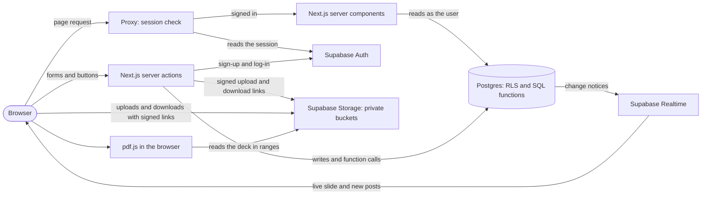

The detail is in [docs/ARCHITECTURE.md](docs/ARCHITECTURE.md).

## Screenshots

| Screen | Light | Dark |
| --- | --- | --- |
| Landing page | 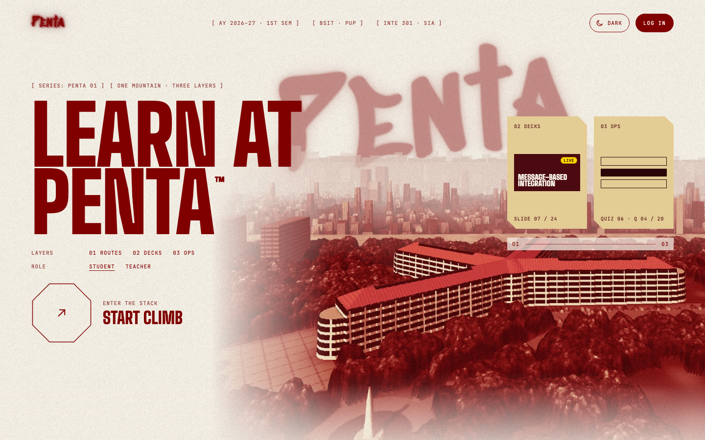 | 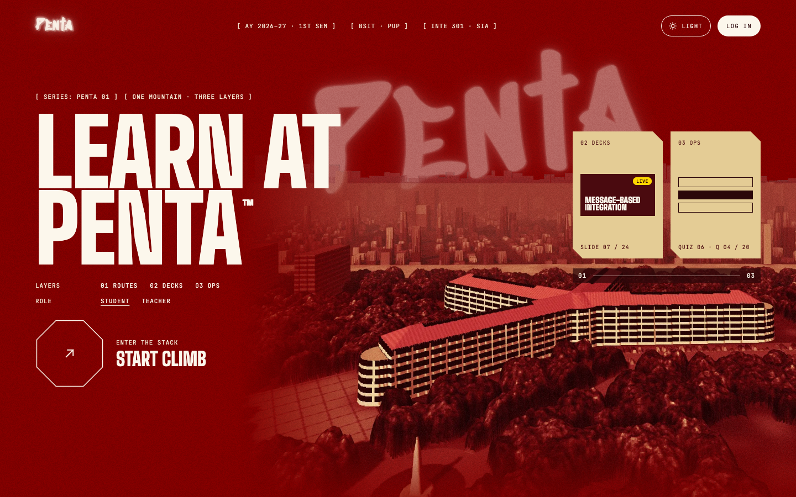 |
| Hub | 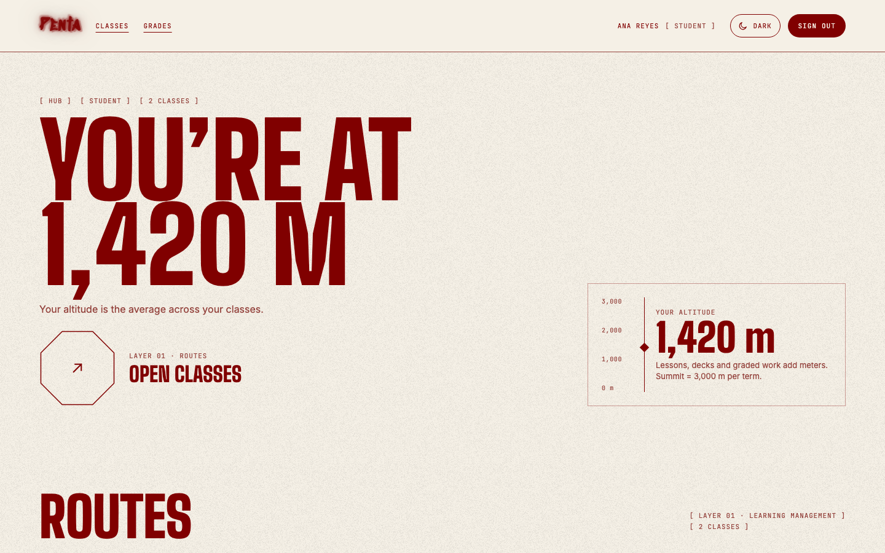 | 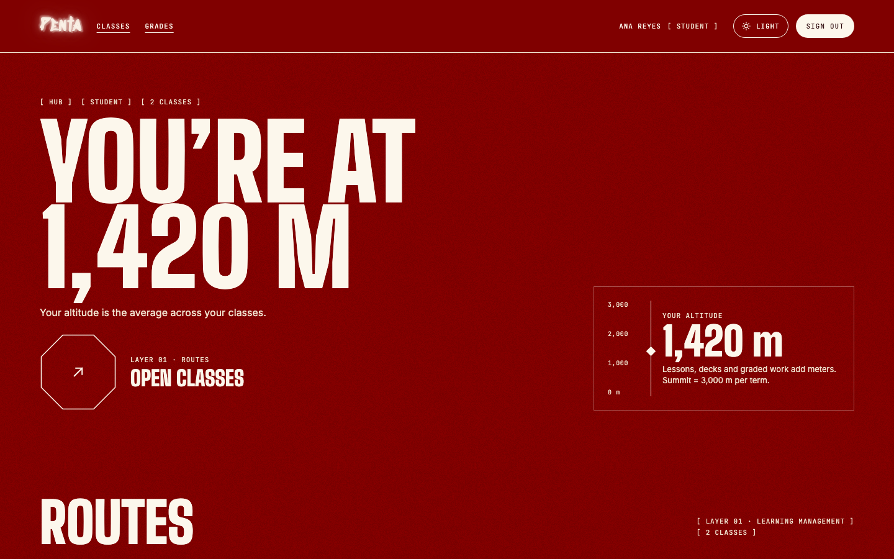 |
| Routes | 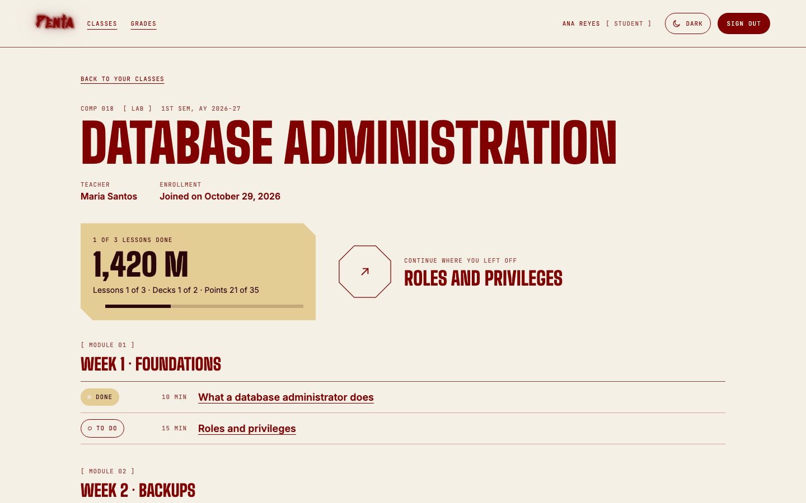 | 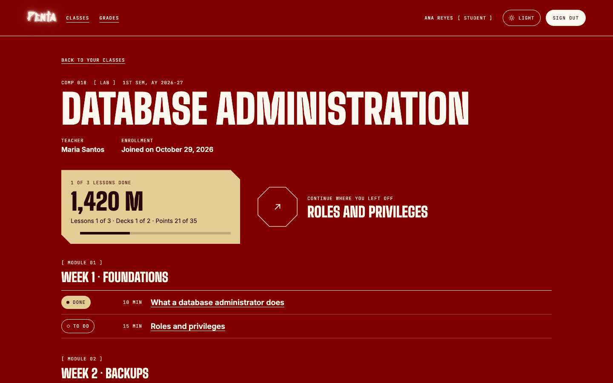 |
| Decks | 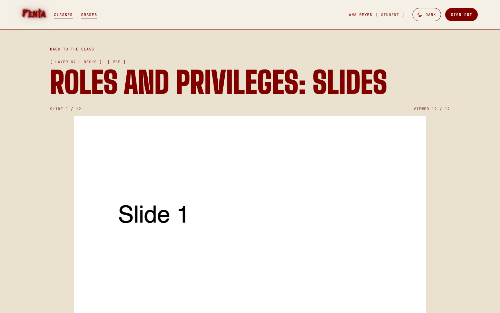 | 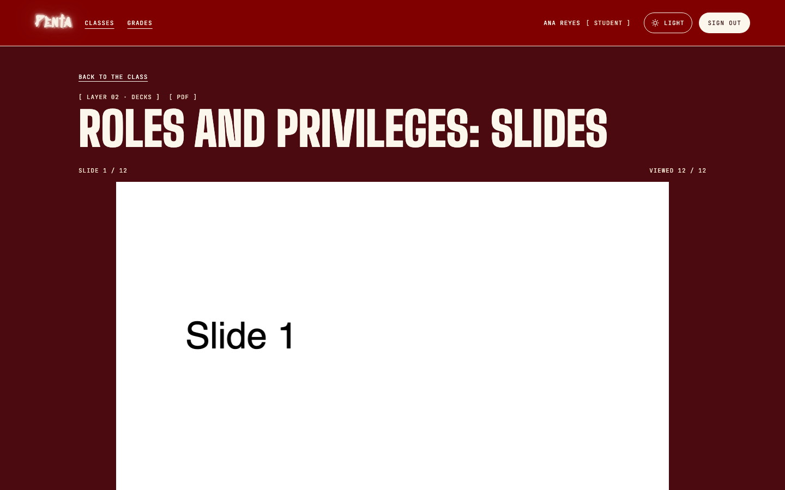 |
| Slide editor | 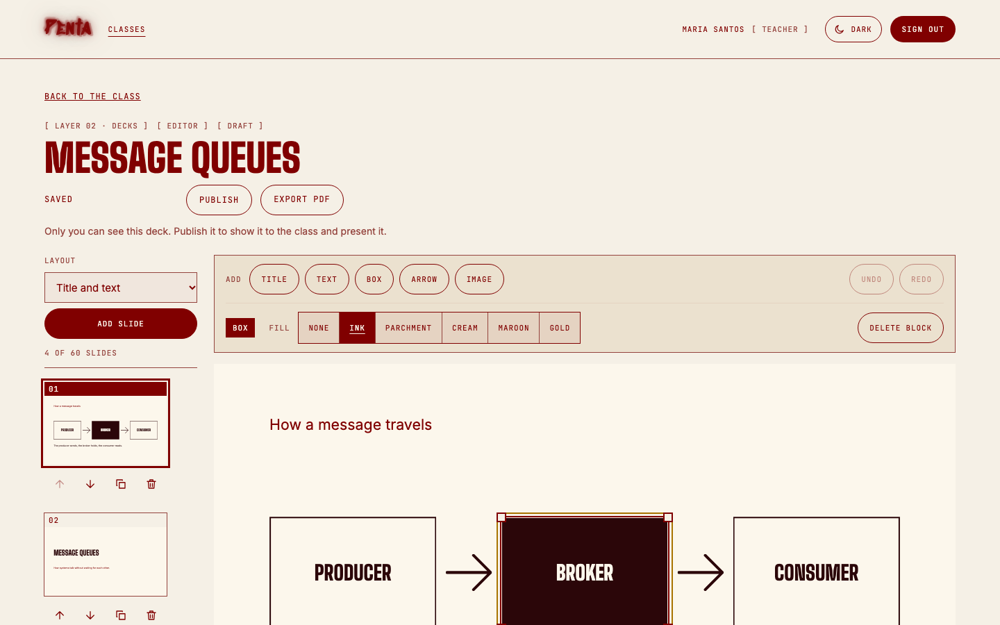 | 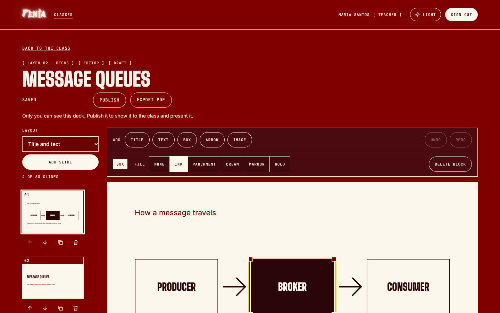 |
| Ops | 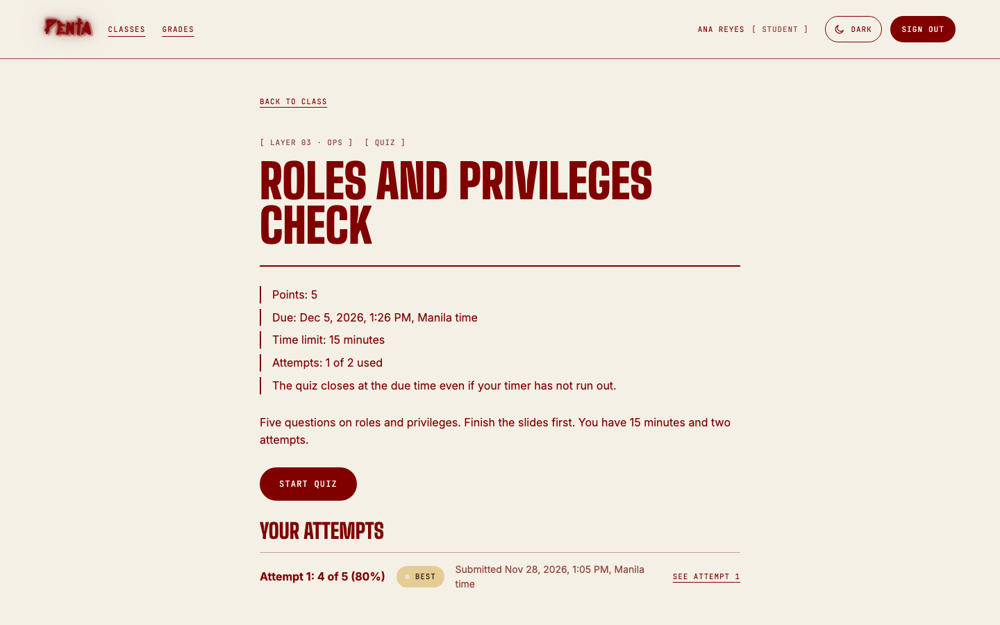 | 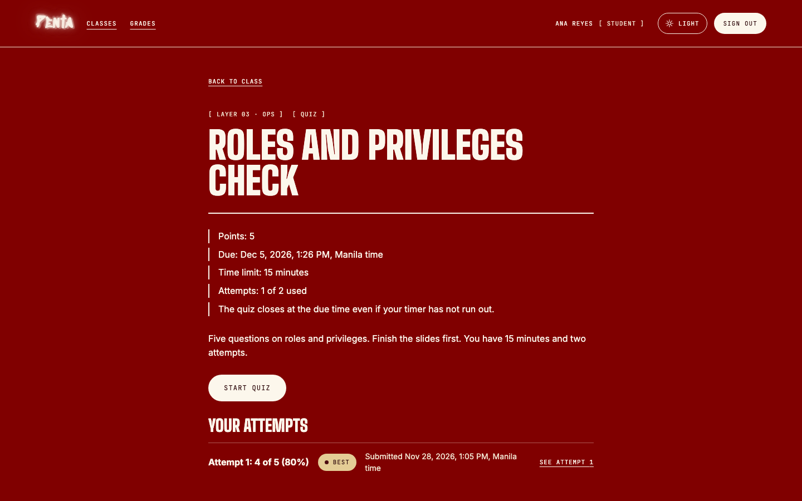 |
| Threads | 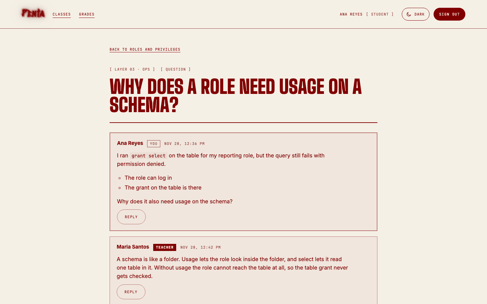 | 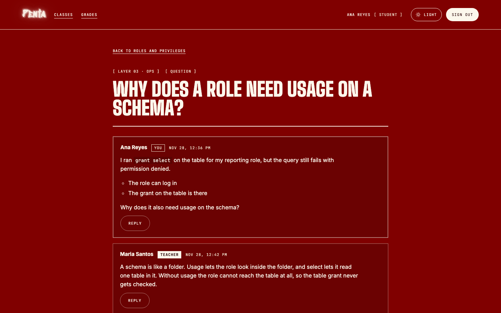 |

## Setup

Prerequisites:

| Tool | Version | Why |
| --- | --- | --- |
| Node.js | 22.13 or newer (`engines` in `package.json`). Continuous integration uses Node 24. | Runs Next.js, the tests and the seed script. |
| npm | Comes with Node. | Installs the packages from `package-lock.json`. |
| Docker Desktop or Podman | Any current version, running. | The local Supabase stack runs in containers. |
| Supabase CLI | 3.4.0, run through `npx supabase@3.4.0`. Nothing to install globally. | Starts the local stack and applies migrations. |

PENTA lives in the `penta/` folder of the repository:

```bash
git clone <repository address>
cd <repository folder>/penta
npm ci
cp .env.example .env.local
```

On Windows, copy with `copy .env.example .env.local`.

## The .env file

Settings are read from `.env.local` in `penta/`. Next.js, the seed script, the database tests and
the end to end tests all read that file. `.env.example` lists the keys with empty values.

| Key | What it is for | Visibility |
| --- | --- | --- |
| `NEXT_PUBLIC_SUPABASE_URL` | The address of the Supabase API. The app, the proxy and the browser client all connect to it. It is also added to the content security policy. | Public. Sent to the browser. |
| `NEXT_PUBLIC_SUPABASE_ANON_KEY` | The public API key. Requests made with it are limited by Row Level Security. | Public. Sent to the browser. |
| `SUPABASE_SERVICE_ROLE_KEY` | The key that bypasses Row Level Security. Used only in server-only code (`src/lib/supabase/admin.ts`), the seed script and the tests. | Server only. Never give it a `NEXT_PUBLIC_` name. |
| `TEACHER_SIGNUP_CODE` | The code a person must type on the sign-up page to get a teacher account. See below. | Server only. |
| `NEXT_PUBLIC_SITE_URL` | The address the app is served from. When it starts with `https://`, the session cookie is marked `Secure`. | Public. |

For the local stack, start it (see [Running the app](#running-the-app)) and run:

```bash
npx supabase@3.4.0 status
```

It prints the local API URL and the two API keys. Copy them into the first three keys. Set
`NEXT_PUBLIC_SITE_URL` to `http://localhost:3000`.

`.env.local` is ignored by git, and so is every other `.env` file except `.env.example`.

### The teacher sign-up code

The sign-up page has an optional "Teacher code" field.

- Left empty, the form creates a student account.
- Filled in, the server compares it with `TEACHER_SIGNUP_CODE`. A match creates a teacher account.
  A wrong code creates nothing and shows "That teacher code is not valid".
- The code must be at least 20 characters long. While `TEACHER_SIGNUP_CODE` is empty or shorter
  than that, no code is accepted and nobody can sign up as a teacher.
- The comparison is done on SHA-256 digests in constant time (`src/lib/teacher-code.ts`), and the
  code never reaches the browser.

Choose any long random text, and give it only to the people who should teach.

## Running the app

Start Docker, then from `penta/`:

```bash
npx supabase@3.4.0 start
npx supabase@3.4.0 migration up
npm run seed
npm run dev
```

Open http://localhost:3000.

| Step | What it does |
| --- | --- |
| `npx supabase@3.4.0 start` | Starts the local Supabase stack: Postgres 17, Auth, Storage and Realtime. |
| `npx supabase@3.4.0 migration up` | Applies any migration in `supabase/migrations` that the local database does not have yet. |
| `npm run seed` | Adds the sample accounts and one sample class with content. It stops unless `NEXT_PUBLIC_SUPABASE_URL` points at `127.0.0.1` or `localhost`. |
| `npm run dev` | Starts the Next.js development server. |

Stop the stack with `npx supabase@3.4.0 stop`.

### Local demo accounts

`npm run seed` creates these accounts in the local database. They are sample data and exist only
on the laptop.

| Role | Email | Name |
| --- | --- | --- |
| Teacher | `teacher@penta.local` | Maria Santos |
| Student | `student1@penta.local` | Ana Reyes |
| Student | `student2@penta.local` | Ben Cruz |
| Student | `student3@penta.local` | Carla Dizon |

The password for every sample account is `penta-local-2026`.

The seed also creates two classes owned by the teacher, with all three students enrolled:
`INTE 301` (empty) and `COMP 018`, Database Administration. `COMP 018` holds two modules, four
lessons (one still a draft), two decks, two quizzes (one a draft), two upload activities with
three hand-ins, and two threads. Ana Reyes has finished the first deck and taken the first quiz.
Ben Cruz has not opened the slides, so that quiz is locked for his account. The seed prints the
accounts, the classes and their join codes when it finishes.

### Other commands

| Command | What it does |
| --- | --- |
| `npm run demo:reset` | Erases the local database, applies every migration again and runs the seed. Use it to return to a known state before a demo. |
| `npm run build` | Builds the production version. |
| `npm run start` | Serves the production build. |
| `npm run verify` | Typecheck, lint, unit tests and a production build, in that order. |
| `npm run types:db` | Regenerates `src/lib/database.types.ts` from the local database. |

## Database and migrations

The schema is plain SQL in `supabase/migrations`. The files are applied in file name order, and
each name starts with a timestamp. Never edit a file that has already been applied. Add a new
file instead.

| Target | How migrations are applied |
| --- | --- |
| Local stack | `npx supabase@3.4.0 migration up` applies the files that have not run yet and keeps the data. `npm run demo:reset` erases the local database and rebuilds it from every file. |
| Cloud project | `npx supabase@3.4.0 link --project-ref <project ref>` once, then `npx supabase@3.4.0 db push --remote`. Add `--dry-run` to list what would run without applying it. |

In this CLI version `db push` targets the local database unless `--remote` is given.

How access is controlled:

- Row Level Security is on for every table. Default grants are closed, and each table gets only
  the column grants and policies it needs.
- A teacher reaches rows of the classes they own. A student reaches rows of the classes they are
  enrolled in, and only published content.
- Simple writes, such as creating a class or editing a lesson, go through those policies and
  column grants. Everything with rules behind it goes through SQL functions in the database:
  joining a class, reordering modules and lessons, reserving and completing a deck upload, saving
  and publishing an editor deck, live mode, starting and submitting a quiz attempt, scoring,
  hand-ins, grading, the gradebook, altitude, and posting, hiding and locking in threads.
- Quiz answer keys are in their own table that students cannot read. Scores are computed in the
  database, never in the browser.
- The two Storage buckets, `decks` and `submissions`, are private. The buckets themselves limit
  file size and file type, and the server checks each stored file's first bytes before it counts.
- The helper functions that policies use are in a `private` schema that the API does not expose.

After changing the schema, regenerate the TypeScript types with the local stack running:

```bash
npm run types:db
```

## Accounts and roles

Sign-up is at `/signup` and log-in at `/login`. A password needs 8 to 72 characters.

### How a student signs up

Fill in the full name, school email and password, and leave "Teacher code" empty. The account is
created as a student. On the local stack email confirmation is off, so the student is signed in
at once. On a cloud project with email confirmation on, the page says to check the inbox first.

### How a teacher signs up

Fill in the same form and type the teacher sign-up code in "Teacher code". The server creates the
account with the teacher role and signs the person in. The role is stored in the account's app
metadata, which a user cannot change, and a database trigger copies it into the `profiles` table.
There is no page that changes a role afterwards.

### What each role can do

| Role | Can do |
| --- | --- |
| Student | Join classes with a join code. Read published lessons and mark them done. View decks and follow a live session. Take quizzes and hand in files. See their own grades, deadlines and altitude. Ask and reply in class threads, and edit their own post for 15 minutes, up to three times. |
| Teacher | Create classes and see each class's join code and roster. Remove a student. Build modules and lessons, and publish them. Upload decks, build decks in the slide editor, and present live. Build quizzes and upload activities, see results, grade hand-ins, and export the gradebook as CSV. Hide posts and lock threads. |

A teacher only reaches the classes they own, and a student only the classes they joined. A
teacher page opened by a student redirects to `/classes`.

### Join codes

- Every class gets a random join code of 10 letters and digits when it is created. The letters I
  and O and the digits 0 and 1 are left out so the code is easy to read aloud. It is shown as two
  groups of five, for example `ABCDE-23456`.
- Only the teacher who owns the class can see its code, on the class page.
- A student types the code on `/classes`. Spaces, dashes and lower case are accepted.
- Five wrong codes within 15 minutes pause joining for that account, and the page says when to
  try again.
- Removing a student from the roster replaces the join code, so the removed student cannot use
  the old one to come back.

## Deploying

PENTA deploys to Vercel, with a Supabase cloud project for the database, Auth, Storage and
Realtime. The numbered steps for releases and for looking after the live site are in
[docs/RUNBOOK.md](docs/RUNBOOK.md).

### Supabase cloud project

1. Create a new project in the Supabase dashboard and note its project ref.
2. From `penta/`, sign in and link the folder to it:

   ```bash
   npx supabase@3.4.0 login
   npx supabase@3.4.0 link --project-ref <project ref>
   ```

3. Push the migrations:

   ```bash
   npx supabase@3.4.0 db push --remote
   ```

4. In the dashboard under Authentication, set the Site URL to the deployed address, and add the
   deployed address to the redirect URLs.
5. Copy the project's API URL, its public key and its service role key for the next part.

Do not run `npm run seed` or `npm run demo:reset` against the cloud project. The seed refuses any
address that is not local.

### Vercel

1. Import the repository in Vercel and set the project's Root Directory to `penta`.
2. Keep the detected Next.js preset. No build setting needs changing.
3. Add these Environment Variables for Production:

   - `NEXT_PUBLIC_SUPABASE_URL`
   - `NEXT_PUBLIC_SUPABASE_ANON_KEY`
   - `SUPABASE_SERVICE_ROLE_KEY`
   - `TEACHER_SIGNUP_CODE`
   - `NEXT_PUBLIC_SITE_URL`

4. Deploy. The `NEXT_PUBLIC_` values are built into the bundle, so redeploy after changing one.

When a release adds a migration, push it to the cloud project before deploying the code that
needs it.

`/api/health` answers with `{"status":"ok","database":true}` when the app is running and can
reach the Supabase API.

Every response carries a `Content-Security-Policy`, `X-Content-Type-Options`, `X-Frame-Options`,
`Referrer-Policy`, `Permissions-Policy` and `Cross-Origin-Opener-Policy` header. A production
build also sends `Strict-Transport-Security`. The policy is built in `src/lib/security-headers.ts`
and allows connections to this site and the Supabase project only.

## Running tests

```bash
npm run verify
npm run test:db
npm run e2e
```

| Command | What it covers | What it needs |
| --- | --- | --- |
| `npm run verify` | Typecheck, ESLint, the unit and component tests under `src/` (Vitest with jsdom), and a production build. | Nothing running. |
| `npm run test:db` | The database tests in `tests/db`: Row Level Security policies, grants, SQL functions, Storage rules and Realtime channel access, each checked as a teacher, a student and an outsider. | The local Supabase stack, with `.env.local` filled in. |
| `npm run e2e` | The Playwright tests in `e2e`, in Chromium and WebKit: accounts, routes, decks, live mode, the slide editor, quizzes, hand-ins, threads, the landing page and both themes. It builds the app and serves it on port 3100. | The local Supabase stack, `.env.local`, and the Playwright browsers (`npx playwright install chromium webkit`). |

The database tests and the end to end tests create their own accounts ending in `@penta.test`
and remove them afterwards. Both refuse to run unless `NEXT_PUBLIC_SUPABASE_URL` points at
`127.0.0.1` or `localhost`, so they cannot touch a cloud project.

The results are in [docs/TEST-REPORT.md](docs/TEST-REPORT.md), and the manual steps for checking
the app by hand are in [docs/QA-CHECKLIST.md](docs/QA-CHECKLIST.md).

## Continuous integration

`.github/workflows/penta.yml`, at the root of the repository, runs on GitHub Actions for every
pull request and every push to `main` that changes a file under `penta/` or the workflow itself.
On Ubuntu 24.04 with Node 24 it runs `npm ci` and then `npm run verify`: typecheck, lint, unit
tests and a production build. A newer run on the same branch cancels the older one, and a run is
stopped after 15 minutes.

The workflow uses no secrets and can only read the repository. It does not run the database
tests or the end to end tests, because those need the local Supabase stack. Run them on a laptop
before a release.

## Project structure

```
penta/
├── src/
│   ├── app/                    pages, route handlers and server actions
│   │   ├── auth/               sign-up, log-in and sign-out actions
│   │   ├── login/, signup/     the two account pages
│   │   ├── hub/                the signed-in home page
│   │   ├── classes/            classes, the outline, lessons and the gradebook (Routes)
│   │   ├── decks/              viewer, editor, print page, uploads and downloads (Decks)
│   │   ├── ops/                quizzes, hand-ins and grading (Ops)
│   │   ├── grades/             a student's own grades and deadlines
│   │   ├── threads/            class threads and moderation
│   │   ├── styleguide/         every shared component on one page
│   │   └── api/health/         health check
│   ├── components/             React components, grouped by feature, with CSS Modules
│   │   └── ui/                 shared pieces: cards, pills, fields, the altitude meter
│   ├── content/                the landing page copy
│   ├── lib/                    logic with no user interface
│   │   ├── config.ts           every limit in one place
│   │   ├── auth.ts             the current user and role checks
│   │   ├── supabase/           server, browser and admin clients, local-only guard
│   │   ├── slides/             the editor's deck format, layouts and autosave
│   │   ├── security-headers.ts the content security policy and other headers
│   │   └── database.types.ts   generated by npm run types:db
│   ├── styles/                 design tokens and global styles
│   └── proxy.ts                session check in front of the signed-in pages
├── supabase/
│   ├── config.jsonc            local stack settings
│   └── migrations/             the schema, policies and SQL functions
├── tests/
│   ├── db/                     database and Row Level Security tests
│   └── fixtures/               small PDF, PPTX and DOCX files built in code
├── e2e/                        Playwright tests
├── scripts/seed.ts             local sample accounts and class content
├── public/design/              landing page images
├── docs/                       architecture, test report, QA checklist and runbook
├── screenshots/                screenshots for this README
├── next.config.ts              applies the security headers
├── playwright.config.ts        end to end test settings
├── vitest.config.mts           unit test settings
├── vitest.db.config.mts        database test settings
└── .env.example                the keys .env.local needs
```

The GitHub Actions workflow lives outside this folder, in `.github/workflows/penta.yml` at the
root of the repository, because GitHub only reads workflows from there.

## Known limitations

- A student hand-in is one PDF or DOCX of 25 MB or less. A deck file is a PDF or PPTX of 50 MB or
  less. The limits are in `src/lib/config.ts`.
- The app is sized for the Supabase free plan: 50 MB per file and 1 GB of storage in total. Decks
  share a budget of 700 MB, and new uploads are refused once stored files reach 900 MB. When
  storage is full the teacher has to delete decks or graded files to make room.
- A PowerPoint file is never converted. The teacher uploads a PDF export, which is what students
  see, and may attach the PPTX as a download. Macro files (`.pptm`) are refused.
- An uploaded deck can have up to 300 slides. A deck made in the editor can have up to 60 slides,
  30 blocks per slide and 40 images of 2 MB or less each.
- The slide editor is desktop first. Below 900 px wide it shows a read-only preview of the slide
  with a note to open the deck on a larger screen.
- Exporting an editor deck to PDF goes through the browser's print dialog. The reader chooses
  Save as PDF, and Safari needs Landscape chosen by hand.
- Quiz submission has no confirmation step. Pressing "Submit quiz" ends the attempt.
- Pages under classes, decks, ops and threads have no loading skeleton. Only the hub and the
  grades page show one while they load.
- Slides are read from Storage in 1 MB ranges, so most decks show the first slide before the
  whole file has arrived. Some PDFs with an unusual internal layout download fully before the
  first slide shows.
- View progress on a deck made in the editor is tracked by slide number. Removing slides drops
  the views of the removed positions, and adding slides asks students to view the new ones before
  the deck counts as finished again.
- Sign-up is open to anyone who has the address. Only the teacher role is protected, by the
  teacher sign-up code.
- A class has no roster cap. Anyone with a student account and the join code can join.
- There is no page for resetting a forgotten password, changing a role, or deleting an account.
- A class has one teacher. There is no co-teacher or assistant role.
- A thread holds up to 200 posts, and a post up to 2,000 characters. Replies go one level deep.
- A quiz has at most 100 questions, 10 attempts and a 300 minute time limit. Identification
  answers are matched against the accepted answers the teacher lists, so a correct answer worded
  differently is marked wrong.
- Times are shown in Manila time.
- Continuous integration runs the typecheck, lint, unit tests and build only. The database and
  end to end tests run on a laptop.
- `npm run dev` is the Next.js development server and is for a laptop only.
