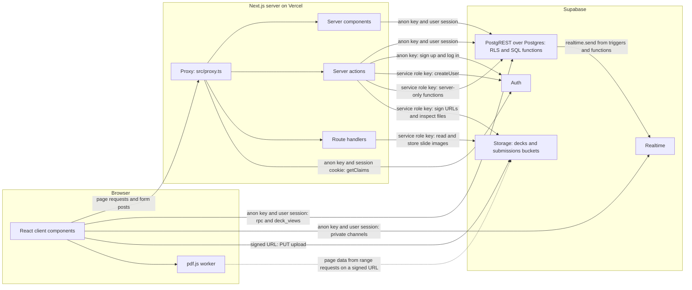
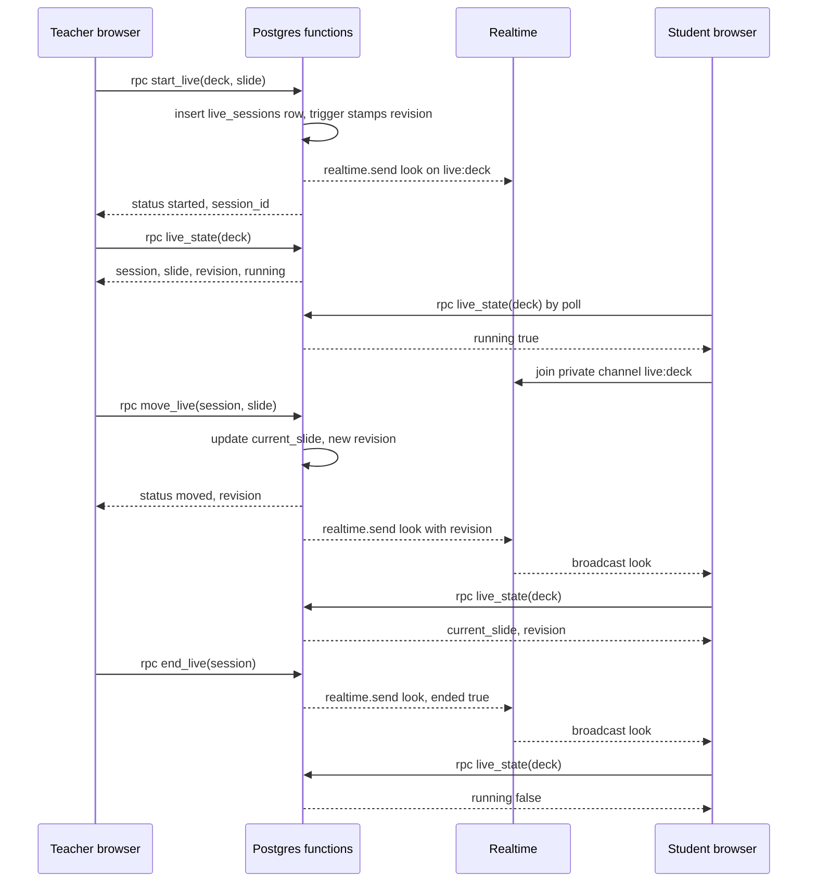
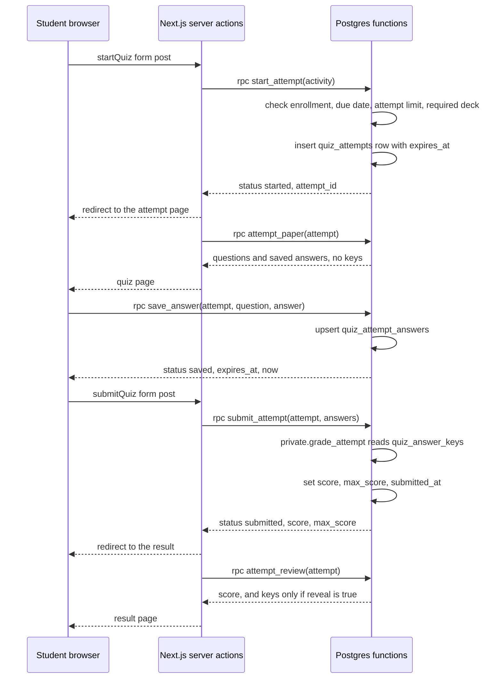
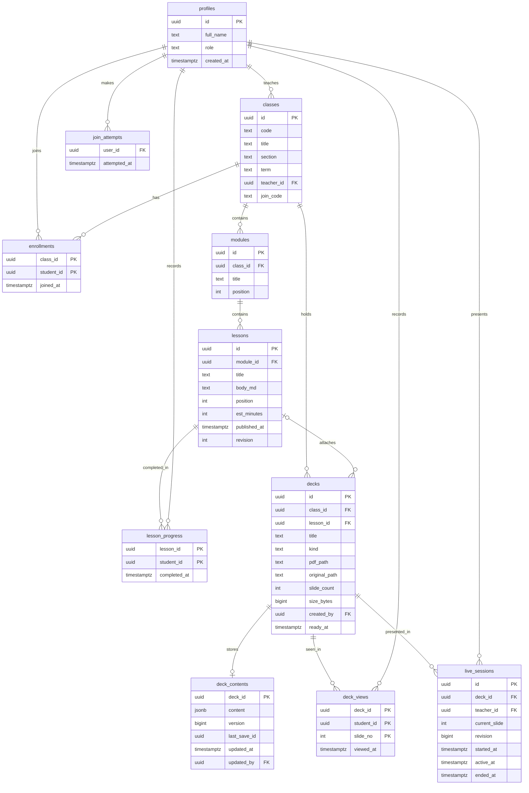
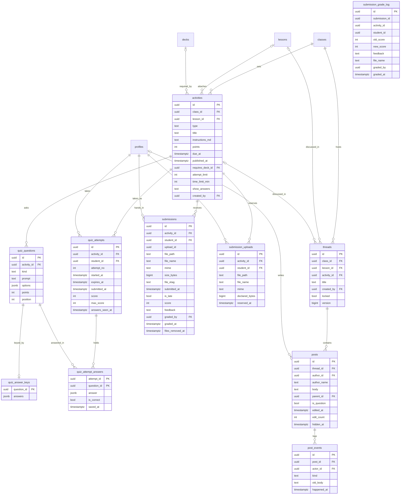

# PENTA architecture

This document describes how PENTA is put together: what runs where, how the parts talk to each other, and where each trust boundary sits. It is written for INTE 301, Systems Integration and Architecture 1, so most of it is about the integration points.

## 1. Overview

PENTA has three runtime tiers.

- **Browser.** React 19 client components render the interface. The browser also runs pdf.js in a web worker to draw uploaded decks, holds a Supabase client that uses the anon key together with the signed-in user's session, and keeps Realtime channels open for live mode and class threads.
- **Next.js 16 on Vercel.** The App Router serves server components, server actions and a few route handlers. A proxy (`src/proxy.ts`) checks the session before any guarded page is rendered. Server code talks to Supabase in two ways: as the user (anon key plus the session cookie) and, in a small set of server-only files, as the service role.
- **Supabase.** One cloud project provides Auth (email and password), Postgres behind PostgREST with Row Level Security on every table, Storage with two private buckets, and Realtime.

Postgres is the authority for every rule that matters: who may read a row, whether a quiz attempt is still open, whether a file fits the storage budget, which slide a live session is on. The Next.js server validates input with zod and shapes messages for people, but it does not decide access on its own.

## 2. System diagram

The service role key exists only on the Next.js server. Every arrow that leaves the browser carries either the anon key with the user's own session or a short-lived signed URL.

## 3. Integration points

### 3.1 Auth

**What it is used for.** Sign up, log in, log out, and proving who the caller is on every request.

**How the call is made.**

- `src/app/auth/actions.ts` holds the `signUp`, `logIn` and `signOut` server actions. Input is validated by `signUpSchema` and `logInSchema` in `src/app/auth/schemas.ts`.
- A student signs up through `supabase.auth.signUp` on the server client, with the anon key.
- A teacher signs up by also sending a teacher code. `isTeacherCode` in `src/lib/teacher-code.ts` compares SHA-256 digests of the input and the `TEACHER_SIGNUP_CODE` environment variable with `timingSafeEqual`, and refuses any configured code shorter than 20 characters. If the code matches, the action creates the account with `auth.admin.createUser` through the service role client and sets `app_metadata.role` to `teacher`. A user cannot write `app_metadata`, so the role cannot be claimed from the browser.
- The session lives in cookies managed by `@supabase/ssr`. `src/lib/supabase/server.ts` builds the server client from the request cookies, `src/lib/supabase/client.ts` builds the browser client, and both share `sessionCookieOptions` from `src/lib/supabase/session-cookie.ts`, which marks the cookie `secure` when `NEXT_PUBLIC_SITE_URL` starts with `https://`.

**The session check in the proxy.** `src/proxy.ts` runs for `/hub`, `/classes`, `/decks`, `/ops`, `/grades`, `/threads`, `/login` and `/signup`. It calls `supabase.auth.getClaims()` and sorts the result into `user`, `guest` or `unavailable`.

- A guest on a guarded path is redirected to `/login?next=...`. After log in, `safeNext` in `src/lib/safe-next.ts` only accepts a same-site path under `/hub` or `/classes`.
- A signed-in user on `/login` or `/signup` is sent to `/hub`.
- If Auth cannot be reached, a guarded path answers 503 with `Retry-After` instead of treating the user as signed out.
- Refreshed session cookies are copied onto whichever response is returned, including redirects.

**Roles.** There are two roles, `student` and `teacher`. The trigger function `private.handle_new_user` creates a `profiles` row for each new `auth.users` row and copies the role from `raw_app_meta_data`. `private.sync_profile_role` keeps it in step, and the `keep_profile_identity` trigger refuses a change to `role` or `id` made as `authenticated` or `anon`. On the server, `getCurrentUser`, `requireUser` and `requireRole` in `src/lib/auth.ts` read the claims and the `profiles` row. These are convenience checks for routing and messages. The database repeats every role check itself.

**When the session ends during a form submit.** The proxy does not redirect a server action request (a `POST` with a `next-action` header), because a redirect would throw away what the user typed. The action answers instead:

- `saveLesson` in `src/app/classes/routes-actions.ts` and `askQuestion`, `addPost` and `editPost` in `src/app/threads/actions.ts` call `getCurrentUser` first. If there is no user they return a "session ended" message together with the typed values, so the text stays in the form while the user logs in again in another tab.
- `saveDeck` in `src/app/decks/editor-actions.ts` returns `{ status: "signed_out" }`. The editor keeps the unsaved content, shows "Not saved. Sign in again in another tab." and retries.
- `reserve_deck` returns the status `signed_out`, which the upload form turns into a message.
- In live mode, `usePresenter` treats a 401 from `move_live` as signed out and tells the presenter instead of retrying the slide.

**Trust boundary.** The cookie is the only thing the browser holds. The server and the database verify it on every call. Role and identity come from the token and the `profiles` table, never from a form field.

**Files.** `src/proxy.ts`, `src/lib/auth.ts`, `src/lib/supabase/server.ts`, `src/lib/supabase/client.ts`, `src/lib/supabase/admin.ts`, `src/lib/supabase/session-cookie.ts`, `src/app/auth/actions.ts`, `src/lib/teacher-code.ts`, `src/lib/safe-next.ts`, `supabase/migrations/20261120000100_profiles.sql`.

### 3.2 Postgres with Row Level Security

**What it is used for.** All application data, all access rules, and every write that has a rule attached.

**How the call is made.** Through PostgREST, using `supabase.from(...)` for plain reads and simple writes and `supabase.rpc(...)` for SQL functions. Server components and server actions call it with the server client. A few client components call it directly from the browser with the same anon key and the user's session: live mode (`start_live`, `move_live`, `touch_live`, `end_live`, `live_state`), quiz autosave (`save_answer`), thread refresh (`thread_view`) and slide view tracking (an upsert into `deck_views`). This is safe because the database, not the caller, decides what each call may do.

**Deny by default.**

- Every table has `enable row level security`, and each migration starts with `revoke all on ... from anon, authenticated` before granting back only what is needed. Many grants are per column, for example `grant update (full_name) on public.profiles`.
- `20261125000100_closed_default_grants.sql` changes the default privileges so that new tables, sequences and functions in `public` start with nothing granted to `anon` or `authenticated`.
- The `anon` role, a visitor who is not signed in, has no table grants and cannot execute any application function.
- Some tables have no grant to `authenticated` at all: `quiz_answer_keys`, `join_attempts`, `submission_uploads`, `threads`, `posts` and `post_events`. They are reachable only through functions.

**Policies per table.** Policies are short because the checks live in helper functions in the `private` schema, apart from the tables and the functions the app calls. The helpers are `security definer` with `set search_path = ''`, so a policy can ask a question such as "does the caller teach this class" without the caller needing direct read access to the tables behind the answer. Examples: `private.is_teacher`, `private.teaches_class`, `private.is_enrolled`, `private.teaches_deck`, `private.reads_deck`, `private.teaches_activity`, `private.takes_activity`, `private.sees_thread`.

**Writes through functions that return a status.** Where a write has rules, the table has no insert or update grant and the write goes through a `security definer` function in `public`. The function reads `auth.uid()`, checks access, locks the rows it needs, and returns a status as text or JSON instead of raising an error. The server action maps the status to a message. Examples of statuses: `reserved`, `full`, `deck_limit`, `refused`, `not_found`, `conflict`, `submitted`, `late`.

**Who may call what.** Each function has explicit `revoke` and `grant execute` lines.

| Callable by signed-in users (`authenticated`) | Callable by the service role only |
| --- | --- |
| `join_class`, `class_join_code`, `remove_student`, `move_module`, `move_lesson` | `complete_deck`, `sweep_decks` |
| `reserve_deck`, `storage_usage`, `deck_view_counts`, `deck_finished` | `create_native_deck`, `save_deck_content`, `publish_native_deck`, `deck_image_room`, `unused_deck_images` |
| `start_live`, `move_live`, `touch_live`, `end_live`, `live_now`, `live_state` | `complete_submission`, `cancel_submission_upload`, `sweep_submissions` |
| `save_quiz_question`, `delete_quiz_question`, `move_quiz_question`, `quiz_keys`, `rekey_quiz_question`, `settle_attempts` | `grade_check` |
| `start_attempt`, `attempt_paper`, `save_answer`, `submit_attempt`, `attempt_review` | |
| `reserve_submission`, `grade_submission`, `drop_graded_files` | |
| `class_gradebook`, `my_grades`, `student_altitude` | |
| `ask_question`, `add_post`, `edit_post`, `set_post_hidden`, `set_thread_locked`, `class_threads`, `thread_view`, `post_history` | |

The service role functions are the ones that act on facts the browser must not supply, such as the real size of a stored file. The Next.js server calls them through `createAdminClient` in `src/lib/supabase/admin.ts`, which is marked `server-only`, after it has checked the user itself. Functions that take an `editor` argument, such as `save_deck_content`, check inside the function that this user teaches the class.

**Concrete examples from the migrations.**

1. *Reading a deck.* `decks_select_teacher_or_reader` in `20261122000300_decks_policies.sql` is `using (private.teaches_deck(id) or private.reads_deck(id))`. `private.reads_deck` is true only when the caller is enrolled in the deck's class, the deck has `ready_at` set, and the lesson it is attached to, if any, is published. A student in another class gets zero rows, not an error.
2. *Quiz answer keys.* `quiz_answer_keys` in `20261125000300_quiz_questions.sql` has RLS on, `revoke all`, no policy and no grant. No query from the browser or from the user's server session can read it. Teachers read keys through `quiz_keys`, which checks `private.teaches_activity`. Students see keys only inside the answer of `attempt_review`, and only when the reveal rule allows it.
3. *Moving a live slide.* `live_sessions` grants `select` only. `move_live` in `20261123000200_live_functions.sql` calls `private.open_live_session`, which locks the row, checks `private.teaches_deck` and the lease, and returns `refused`, `ended` or `open`. A student who calls `move_live` gets `{"status": "refused"}` and nothing changes.

**Trust boundary.** The boundary is the database role. A request arrives as `anon`, `authenticated` or `service_role`, and every table and function states which of those it accepts.

**Files.** `supabase/migrations/*.sql`, `src/lib/database.types.ts` (generated types), and the data loaders `src/lib/classes.ts`, `src/lib/routes.ts`, `src/lib/decks.ts`, `src/lib/quiz.ts`, `src/lib/grades.ts`, `src/lib/threads.ts`. Database and RLS tests live in `tests/db`.

### 3.3 Storage

**What it is used for.** Deck files (PDF, the original PPTX, and images used in decks made in PENTA) in the `decks` bucket, and student hand-ins (PDF or DOCX) in the `submissions` bucket.

**Private buckets.** Both buckets are created with `public = false`, a file size limit (50 MB for `decks`, 25 MB for `submissions`) and a list of allowed MIME types. The migrations add no policies on `storage.objects`, so neither bucket can be read or written with the anon key. Every read and write uses a signed URL made by the server, or the service role client directly.

**Reserve, then upload, then complete.** An upload is three steps so that the file itself never passes through the Next.js server.

1. *Reserve.* `startDeckUpload` in `src/app/decks/upload-actions.ts` calls `reserve_deck` as the user. `startHandIn` in `src/app/ops/handin-actions.ts` calls `reserve_submission`. The function checks access, checks the declared size against the storage budget under an advisory lock, and records the reservation: a `decks` row with `ready_at` null, or a `submission_uploads` row. The storage path is built by the database from ids, and check constraints such as `decks_pdf_path_from_ids` and `submissions_path_from_ids` keep it that way. The client never chooses a path.
2. *Upload.* The server creates a signed upload URL with `createSignedUploadUrl` (`signDeckUploads`, `signSubmissionUpload`). The browser sends the file straight to Storage with a `PUT` from `putFile` in `src/components/decks/teacher/put-file.ts`, with `x-upsert: false`.
3. *Complete.* `finishDeckUpload` or `finishHandIn` inspects the stored file with the service role, then calls `complete_deck` or `complete_submission` with the real byte count read from Storage. A file larger than what was reserved is refused. A file that fails inspection is deleted and its reservation removed.

`sweep_decks` and `sweep_submissions` return the names of files that no row points to, and the server deletes them. The sweeps run at the start and end of upload actions.

**File checks.** The client is not trusted for file type or size. There are three layers, in `src/lib/deck-file.ts`, `src/lib/submission-file.ts`, `src/lib/deck-storage.ts` and `src/lib/submission-storage.ts`:

- *Extension and declared size* before anything is reserved (`checkChosenFile`, `checkChosenSubmission`).
- *MIME type* as stored: the bucket only accepts its allowed types, and `checkStoredFile` and `checkStoredSubmission` compare the stored content type to the expected one.
- *Magic bytes and structure* read back from Storage with range requests (`readRange` in `src/lib/stored-file.ts`). A PDF must start with `%PDF-`, and a hand-in PDF must also contain `%%EOF` near its end. A PPTX or DOCX must start with the zip signature, and its zip directory must list `ppt/presentation.xml` or `word/document.xml`. Files with macros are refused: a PPTX that contains `ppt/vbaProject.bin`, and a DOCX whose content types declare macros.

Slide images are checked by `inspectImage` in `src/lib/slides/image-file.ts`, which reads the PNG, JPEG or WebP header, refuses animated files, and enforces the size limits.

**Signed URLs after an access check.** A signed URL is only made after a row read under RLS proves the caller may see the file.

- The deck page `src/app/decks/[id]/page.tsx` calls `loadDeck` with the user's session. Only if the row comes back does it call `signDeckView`, which signs the PDF for `deckLimits.viewUrlSeconds` (one hour). `refreshDeckSource` in `src/app/decks/view-actions.ts` repeats the check and issues a new URL when the old one expires.
- `src/app/decks/[id]/download/route.ts` and `src/app/ops/[id]/submission/[submissionId]/file/route.ts` do the same check and then redirect to a URL signed for 60 seconds.

**The storage budget.** The numbers are held as functions in the `private` schema: `private.deck_budget_bytes` (700 MB for decks) and `private.storage_block_bytes` (900 MB for everything). `private.storage_free_bytes` subtracts what is stored (`private.stored_bytes`), what is reserved for unfinished decks (`private.reserved_bytes`) and what is pending for hand-ins (`private.pending_submission_bytes`). `reserve_deck`, `reserve_submission`, `create_native_deck` and `deck_image_room` all take the same advisory lock before they check, so two uploads cannot both claim the last free space. `storage_usage` reports the totals to teachers.

**Slide images through a route handler.** Images in decks made in PENTA are small, so they go through the server.

- `POST /decks/[id]/images` (`src/app/decks/[id]/images/route.ts`) accepts one image from the class teacher, checks the origin, checks the bytes, asks `deck_image_room` whether there is room, and stores it under `<class>/<deck>/images/` with a random name.
- `GET /decks/[id]/images/[name]` (`src/app/decks/[id]/images/[name]/route.ts`) loads the deck under RLS, then streams the image with `Content-Security-Policy: default-src 'none'; sandbox` and `X-Content-Type-Options: nosniff`. Slides refer to images by file name only, so no signed URL is ever stored in deck content.

**Trust boundary.** Storage accepts a request only with a signed URL or the service role key. The server signs a URL only after the database has said yes. The database decides the path, the size limit and whether the file counts as complete.

**Files.** `src/lib/deck-storage.ts`, `src/lib/submission-storage.ts`, `src/lib/stored-file.ts`, `src/lib/slide-images.ts`, `src/lib/deck-file.ts`, `src/lib/submission-file.ts`, `src/app/decks/upload-actions.ts`, `src/app/ops/handin-actions.ts`, and the migrations `20261122000400_decks_bucket.sql`, `20261122000500_deck_functions.sql`, `20261126000200_submissions.sql`, `20261126000300_storage_budget.sql`, `20261126000400_submission_functions.sql`, `20261128000400_native_deck_functions.sql`, `20261128000500_decks_bucket_images.sql`.

### 3.4 Realtime

**What it is used for.** Telling open browsers that something changed: the live slide of a deck, or the posts in a thread.

**How the call is made.** The browser joins a private broadcast channel with the user's session. There is one topic per deck, `live:<deck id>` (`liveTopic` in `src/lib/live.ts`), and one per thread, `thread:<thread id>` (`threadTopic` in `src/components/threads/live/thread-sync.ts`). The hooks are `useLiveSession` in `src/components/decks/viewer/live/useLiveSession.ts` and `useThreadLive` in `src/components/threads/useThreadLive.ts`. Messages are sent only by the database, with `realtime.send(..., true)`, from the `announce_live_change` trigger on `live_sessions` and from `private.touch_thread`. Browsers never broadcast.

**Who may join.** Private channels are authorised by RLS policies on `realtime.messages`.

- `live_look_for_teacher_or_reader` lets a user receive broadcasts on a live topic only if `private.teaches_deck` or `private.reads_deck` is true for the deck id parsed from the topic by `private.live_topic_deck`.
- `live_presence_track_by_teacher_or_reader` lets the same people announce that they are following. `live_presence_read_by_teacher` lets only the teacher read presence, which is how the presenter sees a follower count without students seeing each other.
- `thread_look_for_viewers` uses `private.sees_thread` for thread topics.

There is no insert policy for broadcast, so a client cannot send an event to other clients.

**Why events carry no content.** An event is only a hint to look. The live event holds a session id, a revision number and an ended flag. The thread event is an empty object. On receiving one, the browser reads the real state through `live_state` or `thread_view`, which apply the normal access checks at that moment. This means a missed, repeated or out-of-order event cannot show wrong data, and nothing private travels over the channel.

**The polling fallback.** Both hooks also poll, so the page still converges if the socket is blocked or drops. Each delay is spread by plus or minus 20 percent (`pollJitterRatio`) so that a class does not poll in step. The intervals are in `src/lib/config.ts`.

| Setting | Value | Meaning |
| --- | --- | --- |
| `liveLimits.pollUpMilliseconds` | 15000 | Live mode, channel connected |
| `liveLimits.pollDownMilliseconds` | 3000 | Live mode, session running but channel down |
| `liveLimits.pollIdleMilliseconds` | 20000 | No session running |
| `liveLimits.outOfTouchMilliseconds` | 15000 | No successful read for this long shows "out of touch" |
| `liveLimits.lookJitterMilliseconds` | 200 | Random wait before reading after a live event |
| `liveLimits.rejoinMilliseconds` | 2000 | Wait before rebuilding a closed channel |
| `threadLimits.pollUpMilliseconds` | 60000 | Thread, channel connected |
| `threadLimits.pollDownMilliseconds` | 10000 | Thread, channel down |
| `threadLimits.lookJitterMilliseconds` | 300 | Random wait before reading after a thread event |

Polling also runs when the tab becomes visible again and when the browser comes back online.

**Trust boundary.** Joining a channel is checked by the database. What a member can learn from the channel is limited to "something changed".

**Files.** `src/lib/live.ts`, `src/components/decks/viewer/live/*`, `src/components/threads/useThreadLive.ts`, `src/components/threads/live/thread-sync.ts`, `supabase/migrations/20261123000100_live_sessions.sql`, `20261123000300_live_channel_policies.sql`, `20261127000200_thread_access.sql`.

### 3.5 PDF rendering

**What it is used for.** Showing uploaded decks. A PPTX deck is uploaded together with a PDF of the same slides, and the PDF is what the viewer draws.

**How the call is made.**

- `loadPdfjs` in `src/lib/pdf-client.ts` imports `pdfjs-dist` on demand and points `GlobalWorkerOptions.workerSrc` at the worker file bundled with the app, so the worker is served from PENTA's own origin.
- `useDeckDocument` in `src/components/decks/viewer/useDeckDocument.ts` opens the document with a custom `PDFDataRangeTransport`. `createRangeReader` in `src/components/decks/viewer/range-fetch.ts` fetches byte ranges from the signed URL with a `Range` header and expects status 206. The chunk size is `deckLimits.rangeChunkBytes` (1 MB), with `disableAutoFetch` and `disableStream` set, so a large deck opens without downloading the whole file.
- If a range request fails, most likely because the signed URL expired, the reader asks `refreshDeckSource` for a new URL once and retries.
- `useSlideCanvas` in `src/components/decks/viewer/useSlideCanvas.ts` renders the current page to a `<canvas>` sized for the device pixel ratio, cancels a render that is no longer wanted, and reads the page text for screen readers.
- The document is opened with `isEvalSupported: false`, `enableXfa: false` and `stopAtErrors: true`, and pages are rendered with annotations disabled, so links and forms inside a PDF do nothing.

**Why the PDF is never proxied through the server.** A deck can be 50 MB. `storagePlan.functionBodyBytes` in `src/lib/config.ts` records the 4.5 MB body limit of a server function, so the file cannot pass through one in either direction. The browser uploads to and reads from Storage directly, using signed URLs, and the server only signs and inspects.

**Content security policy.** `src/lib/security-headers.ts` builds the policy and `next.config.ts` applies it to every path. The entries that make the viewer work:

| Directive | Value | Why |
| --- | --- | --- |
| `worker-src` | `'self' blob:` | Allows the pdf.js worker from PENTA's own origin |
| `script-src` | `'self' 'unsafe-inline' 'wasm-unsafe-eval'` | Allows WebAssembly to compile without allowing `eval`. `'unsafe-eval'` is added in development only |
| `connect-src` | `'self'`, the Supabase origin and its `wss` address | Allows range requests to Storage, PostgREST calls and the Realtime socket |
| `img-src` | `'self' data: blob:` | Slide images come from PENTA's own route handler |

**Trust boundary.** The PDF is untrusted content made by a user. It is parsed in a worker, drawn as pixels on a canvas, and never inserted into the page as markup.

**Files.** `src/lib/pdf-client.ts`, `src/components/decks/viewer/useDeckDocument.ts`, `src/components/decks/viewer/range-fetch.ts`, `src/components/decks/viewer/useSlideCanvas.ts`, `src/components/decks/viewer/SlideDeck.tsx`, `src/lib/security-headers.ts`, `next.config.ts`.

## 4. Data flow: live mode

**Walk through.**

1. **Present.** `usePresenter` calls `start_live`. The function checks `private.teaches_deck`, locks the deck row, and refuses a deck that is not ready. If a session is already open and inside its lease, it answers `resumed` with that session. Otherwise it closes any stale session and inserts a row into `live_sessions`. The unique index `live_sessions_one_open_per_deck` guarantees one open session per deck.
2. **The revision counter.** The `stamp_live_revision` trigger sets `revision` from the sequence `private.live_revision` on every insert and on every change to `current_slide` or `ended_at`. Revisions only go up, across all sessions. Clients use them to drop stale answers: `applyAnswer` in `src/lib/live.ts` ignores an answer whose revision is lower than the one already held, and `lookNeedsRead` skips a read when an event's revision is older than what the client already holds.
3. **Announce.** The `announce_live_change` trigger calls `realtime.send` with the event name `look` on the topic `live:<deck id>`. If the send fails, the write still succeeds, and polling covers the gap.
4. **Follow.** A student's `useLiveSession` learns that a session is running from `live_state`, joins the private channel, and tracks presence while following. On each `look` it waits a short random time and calls `live_state`, then `followReducer` moves the viewer to the teacher's slide. A student who browses to another slide stops following until they rejoin.
5. **Move.** Slide changes go through a queue (`src/lib/move-queue.ts`) that sends at most one `move_live` every `liveLimits.moveGapMilliseconds` (400 ms) and keeps only the latest target, so fast key presses collapse into one write. `move_live` checks the session through `private.open_live_session`, checks the slide number against `decks.slide_count`, updates `current_slide` and `active_at`, and returns the new revision.
6. **The lease.** `private.live_lease` is 30 minutes. A session counts as running only while `ended_at` is null and `active_at` is inside the lease. The presenter calls `touch_live` every `liveLimits.heartbeatMilliseconds` (5 minutes) to renew it, and each move renews it too. If the teacher closes the laptop, the session stops counting as running once the lease runs out, with no clean-up job. `live_now` uses the same rule to list live decks on the hub.
7. **End session.** `end_live` sets `ended_at`. The trigger sends a last `look` with `ended: true`, followers read `live_state`, see `running: false`, and return to free browsing.

Followers never write to `live_sessions`. They only read `live_state`, which returns a row only when `private.teaches_deck` or `private.reads_deck` is true.

## 5. Data flow: quiz grading

**Walk through.**

1. **Start.** `startQuiz` in `src/app/ops/attempt-actions.ts` calls `start_attempt`. The function requires a published quiz and an enrollment, takes an advisory lock for this student and activity, and grades any expired open attempt through `private.settle_expired`. It answers `resumed` if an attempt is open, `closed` after the due date, `limit` when `attempt_limit` is used up, and `locked` when the activity has `requires_deck_id` and `deck_finished` is false. Otherwise it inserts a `quiz_attempts` row. `expires_at` is the earlier of the time limit and the due date, set from the database clock.
2. **The paper.** `attempt_paper` returns the questions from `quiz_questions` and the answers saved so far. Students have no select policy on `quiz_questions`, so this function is their only way to read questions, and it works only for their own attempt (`private.lock_own_attempt`).
3. **Saving answers.** `useAutosave` in `src/components/ops/taking/useAutosave.ts` calls `save_answer` from the browser when an answer changes. Typed identification answers wait for a short debounce first (`quizLimits.saveDebounceMilliseconds`). `private.store_answer` checks that the question belongs to the quiz and that the answer has a valid shape with `private.valid_answer`, then upserts into `quiz_attempt_answers`. After `expires_at` plus a grace of 15 seconds (`private.quiz_grace`) it answers `late` and stores nothing. The answer includes the server's `now` and `expires_at`, so the timer on the page follows the server clock.
4. **Submitting.** `submitQuiz` calls `submit_attempt` with the answers in the form, as a last save. `private.grade_attempt` then joins each question to `quiz_answer_keys`, sets `is_correct` on every row of `quiz_attempt_answers` with `private.is_correct`, and writes `score`, `max_score` and `submitted_at` on the attempt. Identification answers are compared after `private.normalize_answer`. Submitting twice is harmless: a submitted attempt is returned as it is.
5. **Attempts that are never submitted.** An expired attempt is graded with whatever was saved the next time anyone touches it: `attempt_paper`, `start_attempt`, `settle_attempts` on the teacher's results page, or `private.settle_class` when grades are read.
6. **The result.** `attempt_review` returns the score and the student's own answers. It adds `is_correct` and the accepted answers only when `reveal` is true: `show_answers` is `after_submit`, or it is `after_due` and the due date passed more than one minute ago and the student has no open attempt. With `never`, keys are not returned at all. When keys are revealed it stamps `answers_seen_at`, and `start_attempt` refuses a new attempt for a student who has seen the answers.

**Where the answer keys live, and why a student cannot read them early.**

- Keys are in their own table, `quiz_answer_keys`, one row per question. They are not a column of `quiz_questions`, so no select on questions can leak them.
- The table has no grant and no policy for `authenticated`. A direct query returns a permission error for everyone except the service role and the `security definer` functions.
- `quiz_attempt_answers` holds `is_correct`, and its only select policy is for the class teacher (`quiz_attempt_answers_select_by_teacher`). A student cannot work out the key from their own graded rows.
- Grading runs inside the database, so the keys are never sent to the Next.js server or the browser in order to compute a score.
- The only path that returns keys to a student is `attempt_review`, behind the reveal rule above. A check constraint, `activities_after_submit_single_attempt`, forbids `after_submit` on a quiz with more than one attempt.
- When a teacher corrects a key with `rekey_quiz_question`, every submitted attempt is graded again in the same transaction.

**Hand-in grading.** An upload activity follows the reserve, upload, complete flow from section 3.3. `complete_submission` writes one `submissions` row per student and activity. It sets `submitted_at` to the time the upload was reserved if the upload finished within 30 minutes (`private.upload_window`), so a slow connection does not make a student late, and otherwise to the finish time. `is_late` is true when that time is at or after `due_at`. The teacher opens the file through the route handler, then `gradeSubmission` in `src/app/ops/grading-actions.ts` calls `grade_submission` with the score, the feedback and the `upload_id` the teacher was looking at. If the student replaced the file in the meantime, the ids differ and the function answers `changed` instead of grading the wrong file. Each grade is appended to `submission_grade_log` with the old score, the new score and the file's name, size and etag. A graded submission cannot be replaced. The gradebook reads through `class_gradebook` and `my_grades`, which share `private.grade_cells`: best score for a quiz, given score for a hand-in, and the late flag.

## 6. Data model

All tables are in the `public` schema. The diagrams show the main columns only.

**People, Routes and Decks**

**Ops and threads**

**Grouped by layer.**

- **People and classes.** `profiles` mirrors `auth.users` and holds the role. `classes` belong to one teacher. `enrollments` links students to classes. `join_attempts` records tries at a join code so `join_class` can limit guessing.
- **Routes.** `modules` and `lessons` are ordered by `position`. A lesson is visible to students once `published_at` is set. `lesson_progress` holds one row per finished lesson per student.
- **Decks.** `decks` has a `kind` of `pdf`, `pptx` or `native`. Uploaded decks have `pdf_path` and, for PPTX, `original_path`. A native deck has neither and keeps its slides in `deck_contents`. `deck_views` records each slide a student has seen. `live_sessions` holds live mode state.
- **Ops.** `activities` has a `type` of `quiz` or `upload`. Quizzes use `quiz_questions`, `quiz_answer_keys`, `quiz_attempts` and `quiz_attempt_answers`. Hand-ins use `submission_uploads` for a reservation in progress, `submissions` for the handed-in file and its grade, and `submission_grade_log` as an append-only history. The log has no foreign keys, so it outlives the rows it describes.
- **Threads.** A `threads` row belongs to a class and to exactly one lesson or one activity (`threads_one_target`). `posts` holds the question and its replies, one level deep. `post_events` records edits, hides and unhides. `threads.version` goes up on every change and lets `thread_view` answer `unchanged` to a poll.

Progress is not stored. `student_altitude` computes it on read from lessons done, decks finished and points earned, with weights of 1,200, 600 and 1,200 that add up to the 3,000 m summit.

## 7. The slide editor

**Storage.** A deck made in PENTA is a `decks` row with `kind = 'native'` plus one `deck_contents` row. `deck_contents.content` is a JSON document: `{ v: 1, slides: [{ id, blocks: [...] }] }`. A block is one of `title`, `text`, `image`, `box` or `arrow`, with an integer frame (`x`, `y`, `w`, `h`) on a fixed canvas of 1600 by 900 units (`slideLimits.width` and `slideLimits.height`).

**Validation.** `deckContentSchema` in `src/lib/slides/schema.ts` is a strict zod schema. Unknown keys are refused, every block must fit inside the canvas, ids must be unique across the deck, text is checked for control and hidden characters, and an image block may only name a file that matches `imageFilePattern` (a UUID with a `png`, `jpg` or `webp` extension). There is no field for a URL, HTML or a style string, so a saved deck cannot carry markup. The database checks the outer shape again in `private.deck_content_problem` and caps the stored size with the `deck_contents_size` constraint.

**Saving.** The editor saves by itself after `slideLimits.saveDelayMilliseconds` (1.5 seconds) without edits. The state machine is `saveReducer` in `src/lib/slides/autosave.ts`.

1. The editor calls the `saveDeck` server action with the content, the version it last saw (`knownVersion`) and a new random `saveId`.
2. `saveDeck` checks the user and role, parses the content with `parseDeckContent`, refuses content over `slideLimits.contentMaxBytes` (512 KB), and calls `save_deck_content` through the service role client with the user's id as `editor`.
3. `save_deck_content` checks that `editor` teaches the class and locks the rows. Then:
   - If a live session is running on the deck, it answers `live`. Slides cannot change under an audience.
   - If `deck_contents.version` equals `known_version`, it writes the content, sets `version` to `version + 1`, stores `last_save_id`, and answers `saved` with the new version. This is a compare-and-set.
   - If the versions differ but `last_save_id` equals this `save_id`, the earlier request did succeed and only its answer was lost. It answers `saved` again, so a retry is safe.
   - Otherwise it answers `conflict` with the current version. The editor stops saving and shows "This deck changed elsewhere." The teacher can then choose to keep their copy, which adopts the remote version and saves over it.
   - If an image block names a file that is not in Storage, it answers `missing_image`.
4. A failed or signed-out save is retried with the same `saveId`, with waits from `slideLimits.saveRetryMilliseconds`.
5. After a successful save, `pruneSlideImages` deletes images that are older than a day and no longer used by any slide.

A new deck is created by `create_native_deck` with `ready_at` null, so students cannot see it. `publish_native_deck` sets `ready_at`.

**One renderer.** `SlideRenderer` in `src/components/slides/SlideRenderer.tsx` takes a slide, a width and an image base path. It lays the blocks out at 1600 by 900 with absolute positions and scales the whole slide with a CSS transform, so a slide looks the same at any size. Text is rendered as React text nodes, never as HTML. The same component is used in four places:

| Place | File | Use |
| --- | --- | --- |
| Editor canvas and slide list | `src/components/slides/editor/Canvas.tsx`, `SlideList.tsx`, `Editor.tsx` | Editing surface and thumbnails |
| Viewer | `src/components/decks/viewer/SlideDeck.tsx` | Students and teachers reading the deck |
| Live mode | `src/components/decks/viewer/SlideDeck.tsx` with the hooks in `viewer/live` | Same viewer, with the slide driven by `live_state` |
| Print page | `src/components/slides/PrintDeck.tsx` at `/decks/[id]/print` | One slide per page, for "Export PDF" through the browser's print dialog |

`SlideDeck` picks its source by deck kind: a native deck goes to `SlideRenderer`, an uploaded deck goes to the pdf.js canvas. Everything around the slide (navigation, seen-slide tracking, live mode) is shared. `live_state` also returns `content_version`, so a viewer that is open while the teacher saves a new version refreshes itself.

## 8. Security summary

| Threat | Control |
| --- | --- |
| A student reads another class's data | RLS on every table, with policies built on `private.is_enrolled`, `private.reads_deck`, `private.takes_activity` and `private.sees_thread`. Other classes' rows are simply not returned |
| A student calls a teacher function | Each function checks ownership itself (`private.teaches_deck`, `private.teaches_activity`, `classes.teacher_id`) and answers `refused` or `not_found`. Execute grants are explicit per function |
| A visitor who is not signed in calls the API | `anon` has no table grants and no execute grants. The proxy redirects guests away from guarded pages |
| A user makes themselves a teacher | The role comes from `app_metadata`, which only the service role can set, behind `TEACHER_SIGNUP_CODE`. `keep_profile_identity` blocks role changes on `profiles` |
| A student reads quiz answers before the reveal | `quiz_answer_keys` has no grants and no policies. Grading runs in the database. `attempt_review` returns keys only when the reveal rule passes |
| A student changes a score, a timer or a late flag | No insert or update grants on `quiz_attempts`, `quiz_attempt_answers` or `submissions`. Times come from the database clock |
| File type spoofing | Extension, stored MIME type and magic bytes are all checked. Zip directories are read to confirm PPTX or DOCX. Macro files are refused. Buckets restrict MIME types and size |
| Uploading more than was declared, or filling storage | Reserve first under an advisory lock against the budget. `complete_deck` and `complete_submission` compare the real size to the reservation. Sweeps remove orphan files |
| A leaked file link | Buckets are private. Signed URLs are made only after an RLS read succeeds, and last 60 seconds for downloads and one hour for the viewer |
| The service role key reaching the browser | `SUPABASE_SERVICE_ROLE_KEY` has no `NEXT_PUBLIC_` prefix and is read only in `src/lib/supabase/admin.ts`, which imports `server-only`, so a client import fails the build |
| Cross-site framing | `frame-ancestors 'none'` and `X-Frame-Options: DENY` |
| Scripts in user text | Text is rendered as React text. Markdown goes through `react-markdown` in `src/components/ui/Markdown.tsx` with no raw HTML plugin. Links are limited to `http`, `https` and `mailto`, images become links, and thread posts use `PostMarkdown`, which allows a fixed list of elements and `http` or `https` links only. Database constraints (`private.is_clean_text`, `private.is_clean_body`) refuse control characters. The CSP sets `object-src 'none'`, `base-uri 'self'` and `form-action 'self'` |
| A hostile PDF | Parsed in a worker with `isEvalSupported: false` and `enableXfa: false`, drawn to a canvas, annotations disabled |
| A hostile slide image | Header checked on upload. Served with `nosniff` and a sandboxing CSP |
| Open redirect after log in | `safeNext` accepts only same-site paths under `/hub` or `/classes` |
| Someone eavesdrops on a Realtime channel | Channels are private and gated by policies on `realtime.messages`. Events carry no content |
| Transport downgrade and referrer leaks | `Strict-Transport-Security` in production, `Referrer-Policy: strict-origin-when-cross-origin`, `Cross-Origin-Opener-Policy: same-origin`, and a `Permissions-Policy` that turns off camera, microphone, geolocation and payment |

## 9. Limits and scaling notes

All application limits are in `src/lib/config.ts`. Limits that protect data are repeated in SQL as check constraints or inside functions, because the database cannot trust a number that only exists in the app.

**Plan quotas the design is built around** (`storagePlan`)

| Constant | Value | What it stands for |
| --- | --- | --- |
| `maxFileBytes` | 50 MB | Largest single file on the Supabase free plan |
| `totalBytes` | 1 GB | Total Storage on the Supabase free plan |
| `functionBodyBytes` | 4.5 MB | Largest request body a server function accepts |
| `blockBytes` | 900 MB | Point at which PENTA stops accepting any new file, leaving headroom under 1 GB |

**Main application limits**

| Area | Limit |
| --- | --- |
| Deck upload | PDF or PPTX, 50 MB per file (`deckUpload.maxBytes`), 300 slides, 40 decks per class, 3 unfinished uploads per teacher, 700 MB for all decks (`deckLimits.budgetBytes`) |
| Hand-in | PDF or DOCX, 25 MB (`submissionUpload.maxBytes`), one file per student per activity, 30 minute upload window |
| Signed URLs | Viewer 1 hour, downloads 60 seconds |
| Routes | 30 modules per class, 60 lessons per module, lesson body 50,000 characters, summit at 3,000 m |
| Quiz | 100 questions, 2 to 6 options, up to 10 accepted answers, up to 10 attempts, time limit up to 300 minutes, 15 second grace on submit |
| Slide editor | 60 slides, 30 blocks per slide, content 512 KB, images 2 MB each and 40 per deck, 50 undo steps |
| Threads | Title 160 characters, body 2,000 characters and 60 lines, 5 posts per minute, 200 posts per thread, 3 edits per post within 15 minutes |
| Live mode | 30 minute lease, 5 minute heartbeat, one slide move per 400 ms |

**Scaling notes.**

- **Storage is the tightest limit.** Decks are capped at 700 MB and everything at 900 MB, both below the 1 GB quota, and reservations count before the bytes arrive. Teachers can free space by deleting decks or by removing graded hand-in files with `drop_graded_files`, which keeps the grade and the log.
- **Large files never touch the server.** Uploads and PDF reads go from the browser to Storage, so the 4.5 MB function body limit only applies to slide images, which are capped at 2 MB.
- **Realtime load is kept low on purpose.** Each viewer holds one channel per open deck or thread. Events are tiny, sent once per change by the database, and followed by one read per client that is spread out with random jitter. Thread channels close while the tab is hidden.
- **Polling is the floor, not the plan.** With the channel up, a live viewer polls every 15 seconds and a thread every 60 seconds. With it down, every 3 and 10 seconds. A class of 40 following a live deck with Realtime blocked makes roughly 13 small `live_state` calls per second in total.
- **Writes are serialised where it matters.** The storage budget uses one advisory lock, a quiz start uses a lock per student and activity, and live moves lock a single session row. None of these locks is held across a network call.
- **Access checks cost queries.** Policies call `security definer` helpers that look up classes and enrollments. The tables carry indexes for those lookups, for example `enrollments_student_id_idx`, `classes_teacher_id_idx` and `decks_class_id_idx`.
- **The server is stateless.** No session, live state or upload state is kept in the Next.js process, so any number of server instances can serve the same user.
