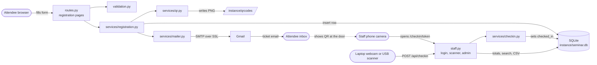

# Seminar Registration with QR Tickets

A Flask web app for a seminar: attendees register on a form, each one gets a QR code ticket by
email, and staff scan the tickets at the door to mark people as checked in.

It runs on one laptop with SQLite, so it needs no server or paid service.

## Features by assignment part

| Part | What the app does | How it was verified |
| --- | --- | --- |
| 1. Registration Form | Form with event name, date, and venue. Browser and server validation, duplicate email check, PH mobile numbers normalized to `+639XXXXXXXXX`, CSRF protection. | 41 automated tests. Three attendees registered through the form in Chrome. |
| 2. Database and QR Script | Each registration is saved to SQLite with an attendee code (`SEM-2026-0001`) and a random ticket token. A labeled QR ticket PNG is generated right after the insert. | 18 automated tests, including decoding each QR back to its check-in URL. Three PNG files created in `instance/qrcodes/`. |
| 3. Automated Email | The ticket is emailed through Gmail SMTP right after the QR is made: QR shown in the body and attached as a PNG. Failures are recorded and never lose the registration. | 17 automated tests with a fake SMTP server. Real emails sent and received in a second Gmail account. |
| 4. Check-in Scanner | Staff PIN login. Tickets are checked in by phone camera, laptop webcam, or USB barcode scanner. Admin dashboard with totals, search, manual check-in, resend email, and CSV export. | 45 automated tests. A ticket scanned with a phone camera, a webcam feed, and typed input. |

The full results are in [docs/TEST-REPORT.md](docs/TEST-REPORT.md).

## Architecture



## Screenshots

Save your screenshots in `screenshots/` with these names and they will show up here.

| File | What to capture |
| --- | --- |
| `screenshots/01-registration-form.png` | The registration form |
| `screenshots/02-registration-confirmation.png` | The confirmation page with the QR ticket |
| `screenshots/03-database-row.png` | The attendee rows in the database |
| `screenshots/04-ticket-email.png` | The ticket email in the inbox |
| `screenshots/05-phone-checked-in.png` | The green check-in page on a phone |
| `screenshots/06-scanner-page.png` | The scanner page after a scan |
| `screenshots/07-admin-dashboard.png` | The admin dashboard |


## Setup

Needs Python 3.11 or newer.

```bash
python -m venv venv
source venv/bin/activate
pip install -r requirements.txt
cp .env.example .env
```

On Windows, activate with `venv\Scripts\activate` and copy with `copy .env.example .env`.

## The .env file

| Key | What it is for | Example |
| --- | --- | --- |
| `SECRET_KEY` | Signs the session cookie. Any long random text. | `f3a9...` |
| `PUBLIC_BASE_URL` | The address written into every QR code. Phones must be able to open it. | `http://192.168.1.23:5000` |
| `MAIL_ENABLED` | `true` sends real email. `false` writes the email to the log. | `true` |
| `SMTP_USER` | The Gmail address that sends the tickets. | `organizer@gmail.com` |
| `SMTP_APP_PASSWORD` | The 16-character Gmail App Password for that account. Spaces are fine. | `abcd efgh ijkl mnop` |
| `MAIL_FROM_NAME` | The sender name attendees see. | `Seminar Registration` |
| `STAFF_PIN` | The PIN staff type at `/staff/login`. Staff pages stay locked while it is empty. | `482913` |
| `EVENT_NAME` | Shown on every page and in the email subject. | `Tech Innovators Seminar 2026` |
| `EVENT_DATE` | Shown on every page and in the email. | `November 30, 2026` |
| `EVENT_VENUE` | Shown on every page and in the email. | `PUP Main Campus, Manila` |

`.env` is ignored by git, so the password and PIN are never committed.

### Gmail App Password

1. Turn on 2-Step Verification for the Gmail account at https://myaccount.google.com/security.
2. Create an App Password at https://myaccount.google.com/apppasswords and copy the 16 characters.
3. Put the Gmail address in `SMTP_USER` and the App Password in `SMTP_APP_PASSWORD`.

## Running the app

```bash
flask --app app init-db
flask --app app run
```

Open http://127.0.0.1:5000 to see the registration form. `init-db` erases every attendee, so run
it only once.

On macOS, AirPlay Receiver already uses port 5000. Add `--port 5001` to the run command and use
that port everywhere below.

| Command | What it does |
| --- | --- |
| `flask --app app init-db` | Creates the database. Erases existing attendees. |
| `flask --app app run` | Starts the app. |
| `flask --app app lan-url` | Prints the laptop's address on the local network. |
| `flask --app app regenerate-qr` | Rebuilds every QR ticket after `PUBLIC_BASE_URL` changes. |
| `flask --app app resend-ticket --code SEM-2026-0001` | Emails one ticket again. |

## Event day check-in

Staff log in at `/staff/login` with `STAFF_PIN`. Five wrong PINs lock login for 60 seconds.

| Page | What it does |
| --- | --- |
| `/checkin/<ticket_token>` | Opens when a phone camera reads a ticket. Green means checked in, amber means already checked in, red means invalid ticket. |
| `/scanner` | Scans with the laptop or tablet camera, and takes input from a USB barcode scanner. |
| `/admin` | Totals, search, manual check-in, resend email, and CSV export. |

The first check-in time is kept. Scanning the same ticket again never overwrites it.

### Option A: phones on the same Wi-Fi or hotspot

```bash
flask --app app lan-url
flask --app app run --host 0.0.0.0
```

`lan-url` prints the laptop's address, for example `http://192.168.1.23:5000`. Put it in
`PUBLIC_BASE_URL`, restart the app, then rebuild and resend tickets made with the old address:

```bash
flask --app app regenerate-qr
flask --app app resend-ticket --code SEM-2026-0001
```

If the phone cannot open the address, allow incoming connections for Python in the firewall
(macOS: System Settings > Network > Firewall; Windows: allow Python on private networks).

On plain `http`, phone browsers block the camera, so `/scanner` works on the laptop only. Phones
can still check people in by scanning the ticket with the phone's own camera app.

### Option B: a tunnel, when the network blocks phone-to-laptop traffic

School and office Wi-Fi often isolate devices. Use a Cloudflare quick tunnel instead:

```bash
cloudflared tunnel --url http://localhost:5000
```

Set `PUBLIC_BASE_URL` to the `https://...trycloudflare.com` address it prints, restart the app,
then regenerate and resend as above. Over `https` the `/scanner` camera also works on a phone.

## Running tests

```bash
pip install -r requirements-dev.txt
pytest
ruff check .
```

There are 121 tests. They use a temporary database and never send real email.

## Project structure

```
seminar-registration/
├── app/
│   ├── __init__.py          app factory
│   ├── config.py            settings read from .env
│   ├── db.py                SQLite connection and init-db
│   ├── schema.sql           attendees table
│   ├── csrf.py              CSRF token check
│   ├── validation.py        form validation and phone normalization
│   ├── routes.py            registration form, confirmation, ticket image
│   ├── staff.py             login, check-in, scanner, admin, CSV export
│   ├── commands.py          regenerate-qr, resend-ticket, lan-url
│   ├── services/
│   │   ├── registration.py  create attendee, deliver ticket
│   │   ├── qr.py            QR ticket image
│   │   ├── mailer.py        ticket email over Gmail SMTP
│   │   └── checkin.py       check-in, totals, search
│   ├── templates/           pages and the ticket email
│   └── static/              stylesheet, form and scanner scripts
├── tests/                   pytest suite
├── docs/TEST-REPORT.md      verification results
├── screenshots/             screenshots for this README and the report
├── requirements.txt         runtime packages
├── requirements-dev.txt     test and lint packages
└── .env.example             the keys .env needs
```

## Known limitations

- It runs on Flask's development server, which suits one laptop at a small event and not the
  public internet.
- Email is sent while the attendee waits, so registering takes about 4 seconds. A slow network
  can make it take up to 15.
- A free Gmail account can send about 500 emails a day.
- A ticket sent to the sending Gmail account itself lands in Sent, not the inbox.
- The scanner page loads `html5-qrcode` 2.3.8 from unpkg, so the laptop needs internet access for
  camera scanning. The typed and USB scanner input works without it.
- Phone browsers only allow the camera over `https`, so `/scanner` on a phone needs the tunnel.
- There is one shared staff PIN and no per-person accounts or record of who checked someone in.
- The wrong-PIN lock is counted per device address and resets when the app restarts.
- A check-in cannot be undone from the dashboard.
- Times are saved in the laptop's local time.
